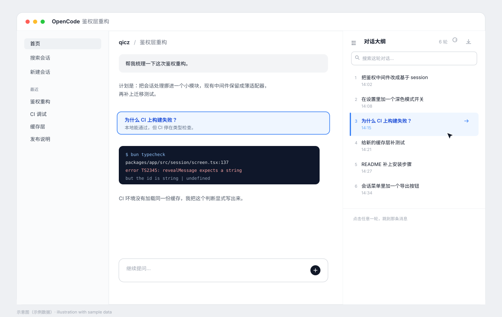
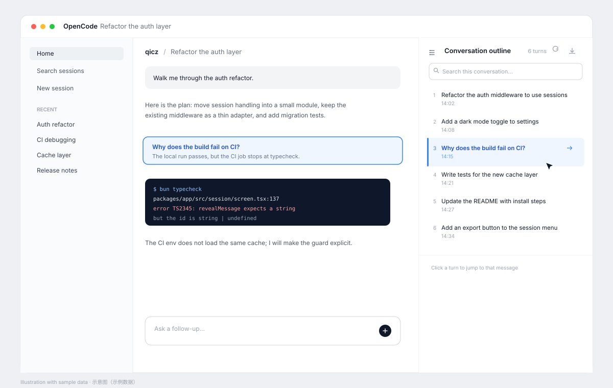

# OpenCode 插件（OpenCode plugins）

OpenCode Desktop 的 GUI 插件合集。

A small collection of GUI plugins for OpenCode Desktop.

## 对话大纲 / Conversation outline

把当前会话的每一轮用户提问列在侧边栏，支持搜索、精确跳转、跳到最新，以及引用到输入框。

Lists every user prompt of the current session in a side panel, with search, precise jumping, jump-to-latest, and quote-into-prompt.





> 示意图（示例数据），不是真实会话内容；上面是中文界面，下面是英文界面。  
> Illustrations with sample data, not a real conversation: Chinese UI above, English UI below.

### 适用版本 / Compatibility

- **OpenCode Desktop 2.2.x** — 已在 macOS 的 **2.2.6** 上测试。
- 使用实验性的 GUI 插件 API（`gui-experimental.cjs`）。其他版本可能需要小调整，尤其是 App 改动时间线 DOM 或内置命令时。
- 仅支持桌面版；CLI/TUI 和 Web 版不会加载 GUI 插件。
- 不需要 Node.js、Bun、npm 或构建步骤。

**English**

- **OpenCode Desktop 2.2.x** — tested with **2.2.6** on macOS.
- Uses the experimental GUI plugin API (`gui-experimental.cjs`). Other versions may need small changes, especially if the app changes its timeline DOM or built-in commands.
- Desktop app only. The CLI/TUI and the web build do not load GUI plugins.
- No Node.js, Bun, npm, or build step is required.

### 语言 / Languages

- 跟随 **App 自己的语言设置**（Settings → General → Language），无需单独配置。
- 内置 **简体中文（`zh`）**、**繁體中文（`zht`）**、**English（`en`）**；英文同时是兜底语言。
- App 切到其他语言时，面板显示英文。加语言只需在 `STRINGS` 里加一份同 key 的文案。

**English**

- Follows the **app's own language setting** (Settings → General → Language); no separate option.
- Ships **Simplified Chinese (`zh`)**, **Traditional Chinese (`zht`)**, and **English (`en`)**; English is also the fallback.
- Any other app language shows English. Adding one means copying a block in `STRINGS`.

### 安装 / Install

1. 把插件目录复制到固定位置：

   ```bash
   cp -R conversation-outline ~/opencode-plugins/conversation-outline
   ```

2. 在 `~/.config/opencode/opencode.jsonc` 里注册**目录**（不是 `.cjs` 文件）：

   ```jsonc
   {
     "$schema": "https://opencode.ai/config.json",
     "plugins": [
       "/absolute/path/to/opencode-plugins/conversation-outline"
     ]
   }
   ```

   必须是绝对路径；Windows 用正斜杠，例如
   `C:/Users/you/opencode-plugins/conversation-outline`。

3. 重启 OpenCode Desktop，在 **Settings → Extensions → Plugins** 里确认插件已启用。

**English**

1. Copy the plugin directory somewhere stable:

   ```bash
   cp -R conversation-outline ~/opencode-plugins/conversation-outline
   ```

2. Register the **directory** (not the `.cjs` file) in `~/.config/opencode/opencode.jsonc`:

   ```jsonc
   {
     "$schema": "https://opencode.ai/config.json",
     "plugins": [
       "/absolute/path/to/opencode-plugins/conversation-outline"
     ]
   }
   ```

   The path must be absolute. On Windows use forward slashes, for example
   `C:/Users/you/opencode-plugins/conversation-outline`.

3. Restart OpenCode Desktop and confirm the plugin under
   **Settings → Extensions → Plugins**.

入口、使用方式、原理、限制和排错见
[conversation-outline/README.md](conversation-outline/README.md)。

See [conversation-outline/README.md](conversation-outline/README.md) for entrances, usage,
implementation notes, limits, and troubleshooting.
