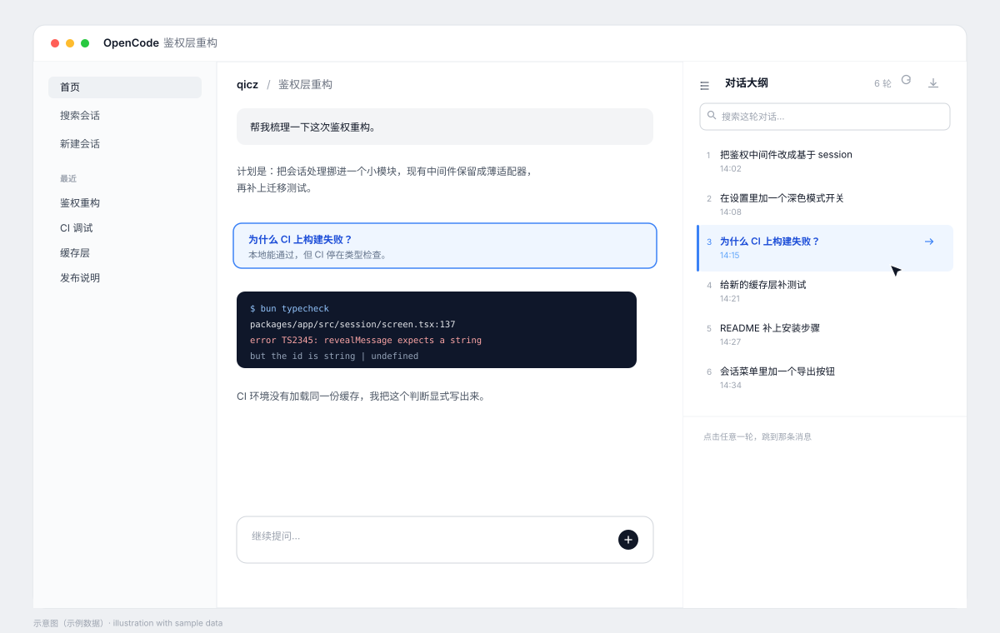
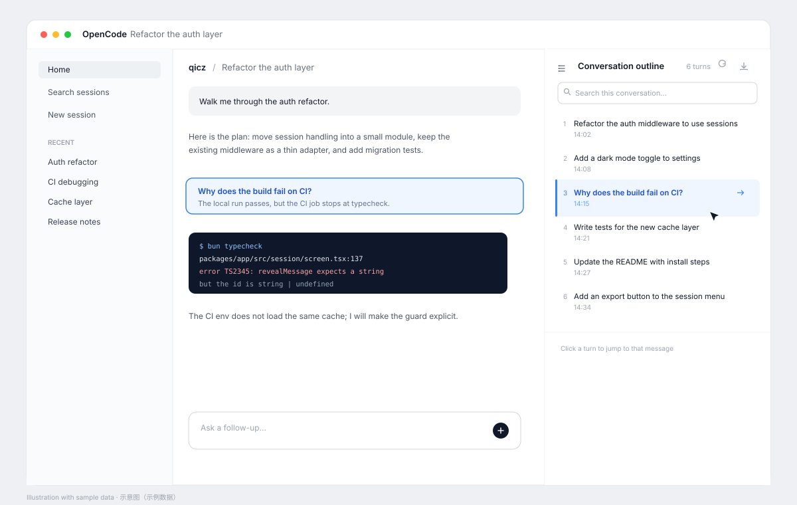

# 对话大纲（Conversation Outline）

OpenCode Desktop 的 GUI 插件：把**当前会话**里的每一轮用户提问列在侧边栏，点一下即可跳到时间线里的对应消息。

A GUI plugin for OpenCode Desktop that lists every user turn of the current conversation in a side panel. Click a turn to jump to that message in the timeline.





> 示意图（示例数据），不是真实会话内容；上面是中文界面，下面是英文界面。  
> Illustrations with sample data, not a real conversation: Chinese UI above, English UI below.

## 适用版本 / Compatibility

- **OpenCode Desktop 2.2.x** — 已在 macOS 的 **2.2.6** 上测试。
- 使用实验性的 GUI 插件 API（`./gui-experimental.cjs`）。其他版本可能需要小调整，尤其是 App 改动时间线 DOM 或内置命令时。
- 仅支持桌面版；CLI/TUI 和 Web 版不会加载 GUI 插件。
- 不需要 Node.js、Bun、npm 或构建步骤。

**English**

- **OpenCode Desktop 2.2.x** — tested with **2.2.6** on macOS.
- Uses the experimental GUI plugin API (`./gui-experimental.cjs`). Other versions may need small changes, especially if the app changes its timeline DOM or built-in commands.
- Desktop app only. The CLI/TUI and the web build do not load GUI plugins.
- No Node.js, Bun, npm, or build step is required.

## 语言 / Languages

- 跟随 **App 自己的语言设置**（Settings → General → Language），无需单独配置。
- 内置 **简体中文（`zh`）**、**繁體中文（`zht`）**、**English（`en`）** 三套文案；英文同时是兜底语言。
- App 切到其他语言时，面板显示英文；命令面板和菜单项同样跟随切换。
- 轮次数量用 App 的复数规则（`ctx.plural`）渲染，例如 `1 turn` / `5 turns`。
- 想加别的语言：在 `gui-experimental.cjs` 顶部的 `STRINGS` 里按同样 key 加一份即可，key 用 App 的 locale id（如 `ja`、`de`）。

**English**

- Follows the **app's own language setting** (Settings → General → Language); no separate option.
- Ships **Simplified Chinese (`zh`)**, **Traditional Chinese (`zht`)**, and **English (`en`)**; English is also the fallback.
- Any other app language shows English, including the command palette entry and menu item.
- The turn count uses the app's plural rules (`ctx.plural`), e.g. `1 turn` / `5 turns`.
- To add a language, copy a block in `STRINGS` at the top of `gui-experimental.cjs` and use the app's locale id (`ja`, `de`, …).

## 功能 / Features

- 列出当前会话的每一轮用户提问，支持搜索和显示时间。
- 点击一轮，时间线滚动到对应消息。
- 跳到最新消息，并把焦点放进输入框。
- 把某一轮提问作为引用放进输入框。
- 数据直接读 server API，不复制、不落盘。

**English**

- Lists every user prompt of the routed session, with search and timestamps.
- Click a turn to reveal that exact message in the timeline.
- Jump to the latest message and focus the prompt.
- Quote a turn into the prompt as a quote attachment.
- Data comes from the server API; nothing is copied or persisted.

## 安装 / Install

1. 把 `conversation-outline` 目录复制到一个固定位置，例如：

   ```bash
   cp -R conversation-outline ~/opencode-plugins/conversation-outline
   ```

2. 在 `~/.config/opencode/opencode.jsonc` 里注册**目录**（不是 `.cjs` 文件）：

   ```jsonc
   {
     "$schema": "https://opencode.ai/config.json",
     "plugins": [
       "/absolute/path/to/opencode-plugins/conversation-outline"
     ]
   }
   ```

   必须是绝对路径；Windows 用正斜杠，例如
   `C:/Users/you/opencode-plugins/conversation-outline`。

3. 重启 OpenCode Desktop，在 **Settings → Extensions → Plugins** 里确认插件已启用。

**English**

1. Copy the `conversation-outline` directory somewhere stable, for example:

   ```bash
   cp -R conversation-outline ~/opencode-plugins/conversation-outline
   ```

2. Register the **directory** (not the `.cjs` file) in `~/.config/opencode/opencode.jsonc`:

   ```jsonc
   {
     "$schema": "https://opencode.ai/config.json",
     "plugins": [
       "/absolute/path/to/opencode-plugins/conversation-outline"
     ]
   }
   ```

   The path must be absolute. On Windows, use forward slashes, for example
   `C:/Users/you/opencode-plugins/conversation-outline`.

3. Restart OpenCode Desktop, then confirm the plugin under
   **Settings → Extensions → Plugins**.

## 入口 / Entrances

| 入口 | 位置 |
| --- | --- |
| 会话标题栏图标 | 会话标题右侧（列表图标） |
| 侧边栏 “+” 菜单 | 选择「对话大纲」 |
| 命令面板 | 搜索「打开对话大纲」 |

| Entry | Location |
| --- | --- |
| Session header icon | Right side of the session title (list icon) |
| Side panel “+” menu | Choose “Conversation outline” |
| Command palette | Search “Open conversation outline” |

## 使用 / Usage

- **搜索框**只过滤当前会话的提问。
- **点击一轮**会让时间线滚动到对应消息，并短暂描边。
- **跳到最新**（右上角向下箭头）回到时间线底部，并把焦点放进输入框。
- **引用**（每行右侧图标）把这一轮提问作为引用放进输入框。
- 面板会后台刷新；数据没变化时不会重建列表。

**English**

- **Search** filters the prompts of the current conversation only.
- **Click a turn** scrolls the timeline to that message and highlights it briefly.
- **Jump to latest** (top-right arrow) returns to the bottom and focuses the prompt.
- **Quote** (icon on the right of a row) attaches that turn to the prompt.
- The panel refreshes in the background and does not rebuild the list when the data is unchanged.

## 跳转原理 / How jumping works

1. 通过 `ctx.client.message.list({ sessionID, type: "user", order: "asc", limit: "200" })` 获取提问，超过 200 轮时用 `cursor` 续拉。
2. 如果提问行已经渲染，直接滚过去。
3. 否则优先调用 App 自带的 `message.previous` / `message.next` 命令，每次都是内部精确跳转。
4. 命令不可用时，退出“跟随最新消息”，在时间线里按位置二分，并且只认**用户提问**那一行。
5. 落位后对齐到视口顶部附近，只描边一次，并缓存位置供下次点击。

**English**

1. Prompts come from `ctx.client.message.list({ sessionID, type: "user", order: "asc", limit: "200" })`, paged with `cursor` beyond 200 turns.
2. If the user message row is already rendered, the timeline scrolls to it directly.
3. Otherwise the plugin uses the app's `message.previous` / `message.next` commands when available. Each command is an internal, precise jump.
4. If those commands are unavailable, it detaches “follow latest”, binary-searches the timeline scroll positions, and accepts only the **user question** row.
5. The landing is aligned near the top, outlined once, and cached for later clicks.

## 已知限制 / Limits

- 只列出用户提问，不含助手回复和工具调用。
- 单会话最多 2000 轮提问（10 页 × 200）。
- 依赖 OpenCode 2.2.x 的内部结构：`data-message-id`、`data-component="user-message"`、时间线滚动容器，以及 `message.previous` / `message.next` 命令 id；上游改动可能需要同步调整。
- App 不再渲染的轮次（例如压缩或 fork 之后）无法跳转。
- 使用 App 内置的精灵图标；上游改名需要同步调整。
- GUI 插件 API 仍是实验性的，版本之间可能变化。

**English**

- Lists user prompts only; assistant replies and tool calls are not listed.
- Up to 2000 turns per session (10 × 200).
- Depends on OpenCode 2.2.x internals: `data-message-id`, `data-component="user-message"`, the timeline scroller, and the `message.previous` / `message.next` command ids. Upstream changes may require an update.
- Turns that the app no longer renders (for example after compaction or a fork) cannot be jumped to.
- Uses the app's built-in sprite icons; upstream renames may require an update.
- The GUI plugin API is experimental and may change between releases.

## 排错 / Troubleshooting

- **Settings 里看不到插件** — 确认 `plugins` 里是绝对**目录**路径，且目录下有 `gui-experimental.cjs`。
- **面板空白或打不开** — 先选中一个会话（Home 页没有当前会话）；在 App 开发者工具里看插件报错。
- **点击不跳转** — 确认该轮属于当前会话；很长的会话可能需要一点时间分页加载历史。
- **App 更新后失效** — 对照上面的适用版本说明；时间线 DOM 或命令 id 可能已变化。

**English**

- **Plugin not listed in Settings** — make sure `plugins` contains the absolute **directory** path and the directory contains `gui-experimental.cjs`.
- **Panel is empty or does not open** — select a session first; the Home page has no current session. Check the app developer console for plugin errors.
- **Clicking a turn does not jump** — confirm the turn belongs to the current session. Very long sessions may need a moment to page history in.
- **Nothing works after an app update** — check the compatibility notes above; the timeline DOM or command ids may have changed.

## 文件 / Files

```text
conversation-outline/
└── gui-experimental.cjs   # 单文件 CommonJS，无需构建 / single CommonJS file, no build
```
